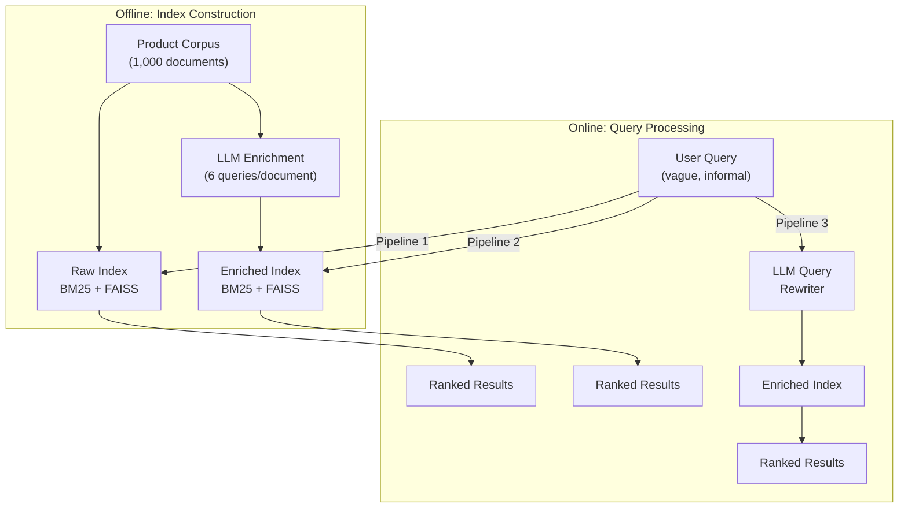
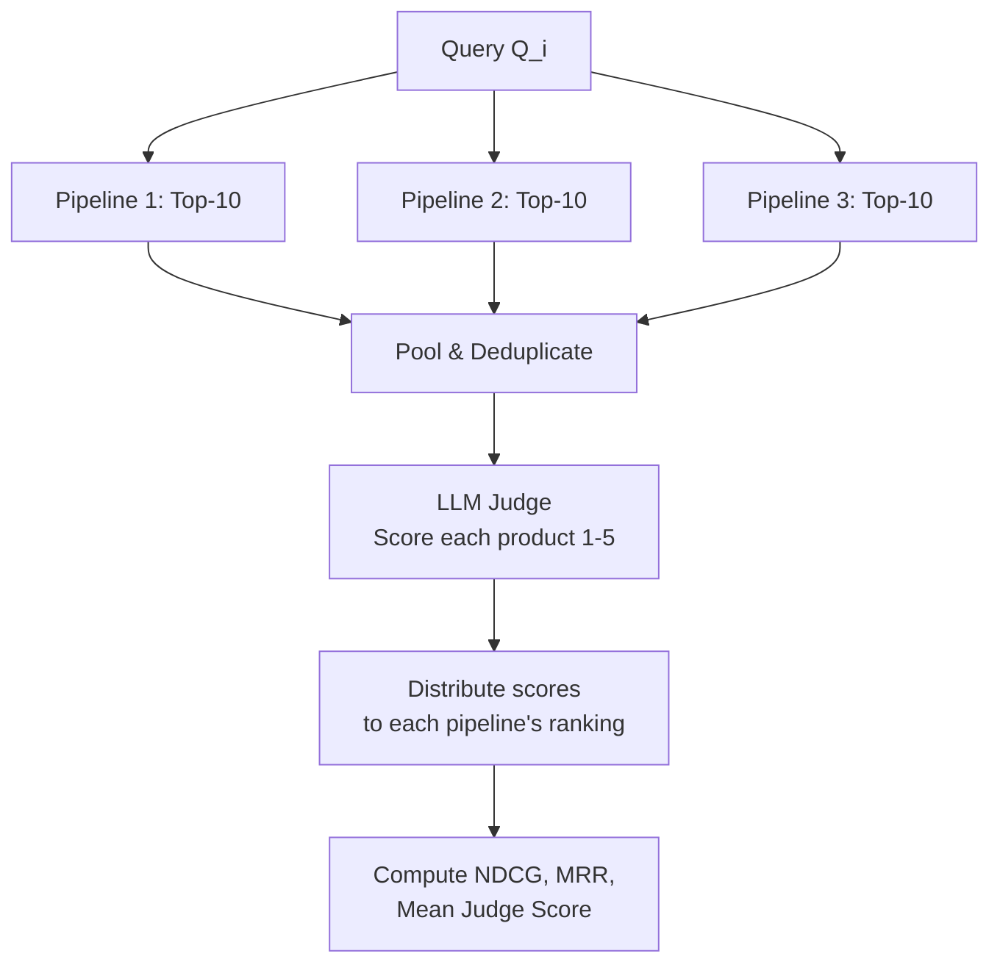

# LLM-Augmented Hybrid Retrieval for Informal Queries in Specialised Domain Marketplaces: A Comparative Study of Document and Query Enrichment Strategies

The full write-up of the project: background, method, results and limits. Written by Aryan Thakur. All figures
come from the run of 21 April 2026 stored in [`results.json`](../results.json); the
[results viewer](../webui/results-viewer.html) shows the same data query by query.

---

## Summary

Specialised domain marketplaces face a persistent retrieval challenge: non-expert users search using vague, informal language while product catalogs employ domain-specific technical terminology. This vocabulary gap between query register and document register degrades retrieval performance in conventional search systems. This study investigates whether Large Language Models (LLMs) can bridge this gap through two complementary enrichment strategies applied to a hybrid BM25 + dense semantic retrieval stack. We compare three pipelines: (1) a baseline weighted hybrid search on raw product documents, (2) hybrid search on an LLM-enriched index where each document is augmented with generated user-like queries, and (3) LLM-driven query rewriting combined with the enriched index. Using a construction waste management marketplace as our case study domain, we evaluate over a corpus of 1,000 products and 50 intentionally vague test queries. Evaluation employs a pooled LLM-as-judge methodology, computing NDCG@k, MRR, and mean relevance scores without requiring pre-labelled relevance judgments. Our results characterise the conditions under which document-side enrichment, query-side rewriting, and their combination improve retrieval quality for informal user queries in specialised verticals.

**Keywords:** information retrieval, hybrid search, large language models, document enrichment, query rewriting, vocabulary gap, domain-specific search, BM25, dense retrieval, LLM-as-judge

---

## 1. Introduction

Specialised domain marketplaces -- platforms connecting buyers and sellers of niche products in verticals such as industrial equipment, building materials, medical supplies, and agricultural commodities -- present a distinctive information retrieval challenge. Product listings in these marketplaces are typically authored by domain experts using precise technical terminology, material specifications, and compliance references. The users searching these platforms, however, are frequently non-specialists who describe their needs in informal, incomplete, and technically imprecise language.

This asymmetry constitutes a **vocabulary gap** that is distinct from the traditional query-document mismatch studied in general web search. In web search, vocabulary mismatch arises from ambiguity and synonymy within a shared language register. In domain marketplace search, the gap is between registers: technical catalog language versus colloquial buyer language. A buyer searching for "something strong for the floor" is operating in a fundamentally different linguistic register from a product listing describing "hand-cleaned kiln-sound solid brick batch with compressive strength certification."

Traditional approaches to vocabulary mismatch include query expansion via pseudo-relevance feedback (Carpineto & Romano, 2012), synonym injection, and relevance feedback loops. Dense retrieval methods using pre-trained language model embeddings (Karpukhin et al., 2020) capture semantic similarity beyond lexical overlap, and hybrid retrieval strategies combining sparse (BM25) and dense components have demonstrated robust performance across diverse benchmarks (Lin et al., 2021). However, the specific challenge of bridging informal user language with domain-specific technical catalogs in vertically-specialised marketplaces remains underexplored.

Large Language Models (LLMs) offer a new mechanism for addressing this gap. Rather than relying solely on the retrieval model to bridge vocabulary mismatches at query time, LLMs can be employed proactively on both sides of the retrieval equation:

1. **Document-side enrichment**: Augmenting each product listing with LLM-generated informal queries that a non-expert user might plausibly use to find that product, embedding colloquial language directly into the search index.
2. **Query-side rewriting**: Using an LLM to interpret a vague user query, simulate a clarification process, and produce a richer, more specific query before retrieval.

This study conducts a controlled comparison of these strategies using a construction waste management (CWM) marketplace as a case study. CWM platforms represent an ideal test domain: the product catalog spans diverse material categories with rich technical descriptions, while the target user base (site managers, contractors, renovators) operates with informal language and imprecise specifications. We construct a corpus of 1,000 products across 50 categories and evaluate three retrieval pipelines against 50 intentionally vague test queries.

### Research Questions

- **RQ1**: Does document-side LLM enrichment improve hybrid retrieval quality for informal, underspecified user queries?
- **RQ2**: Does query-side LLM rewriting, combined with document-side enrichment, yield additional retrieval gains?
- **RQ3**: What are the failure modes and trade-offs of LLM-augmented retrieval in specialised domain search?

### Contributions

1. A comparative evaluation framework for LLM-augmented retrieval in domain-specific marketplace search
2. An unbiased document enrichment methodology that preserves natural vocabulary overlap between user and catalog language
3. Empirical evidence on the relative effectiveness of document-side, query-side, and combined enrichment strategies
4. A pooled LLM-as-judge evaluation design that eliminates the need for pre-labelled relevance judgments

---

## 2. Related Work

### 2.1 Hybrid Sparse-Dense Retrieval

Modern information retrieval commonly combines sparse and dense retrieval components to exploit their complementary strengths. BM25 (Robertson & Zaragoza, 2009) remains a strong sparse baseline due to its effectiveness with exact lexical matches and computational efficiency. Dense retrieval using pre-trained language models encodes queries and documents into a shared embedding space, enabling semantic matching beyond surface-level keyword overlap (Karpukhin et al., 2020).

Hybrid approaches that fuse BM25 and dense scores have shown consistent gains over either component alone. Lin et al. (2021) demonstrated that simple score interpolation between BM25 and dense retrievers improves recall significantly. The complementarity is particularly beneficial when queries contain a mix of specific keywords and broader semantic intent -- precisely the pattern observed in marketplace search where users might combine a material name with an informal use-case description.

### 2.2 Document Enrichment and Expansion

The idea of expanding documents to improve retrieval predates LLMs. Nogueira et al. (2019) proposed doc2query, where a neural model generates potential queries for each document, which are appended to the document for indexing. This was refined with docTTTTTquery (Nogueira & Lin, 2019), showing that T5-generated expansion queries meaningfully improve retrieval effectiveness across TREC benchmarks.

With instruction-following LLMs, document expansion has become more flexible. Jagerman et al. (2023) explored using LLMs for synthetic query generation, hypothetical answers, and paraphrased summaries. Our approach builds on this lineage but differs in a key design choice: we do not artificially constrain the generated queries to avoid catalog terminology. If a natural user query would happen to use the same terms as the product listing, that overlap is preserved. This unbiased generation produces enrichment that more faithfully represents real user search behaviour.

### 2.3 Query Rewriting and Expansion

Query rewriting has a long history in IR. Pseudo-relevance feedback (Rocchio, 1971) expands queries using terms from initially retrieved documents. Neural approaches have automated this: Nogueira & Cho (2017) used sequence-to-sequence models for reformulation, while Yu et al. (2020) explored reinforcement learning for conversational query rewriting.

LLM-based query rewriting represents the current frontier. Wang et al. (2023) proposed Query2Doc, where LLMs generate pseudo-documents from queries for enrichment. Gao et al. (2023) introduced HyDE (Hypothetical Document Embeddings), embedding LLM-generated hypothetical answers instead of raw queries. Ma et al. (2023) demonstrated that chain-of-thought query decomposition improves retrieval for complex information needs.

Our query rewriting approach differs: the LLM simulates an internal clarification process -- asking itself what the user likely needs based on the vague input, then producing a single consolidated rewritten query. This reflects the practical constraint that automated evaluation cannot accommodate interactive multi-turn clarification, while still capturing the intent-disambiguation benefit of conversational search.

### 2.4 LLM-as-Judge Evaluation

Traditional retrieval evaluation relies on human-annotated relevance judgments, which are expensive and hard to scale. Recent work has explored LLMs as surrogate judges. Thomas et al. (2024) showed that GPT-4 judgments correlate strongly with human assessments on TREC benchmarks. Faggioli et al. (2023) found that while LLM judges exhibit systematic biases, they produce consistent and usable relevance orderings.

Our evaluation adopts a pooled judging design inspired by TREC methodology (Voorhees, 2000): results from all pipelines are merged per query, deduplicated, and judged once. This ensures fair cross-pipeline comparison and avoids the methodological flaw of independent judging, which could introduce inconsistent scoring across pipelines.

### 2.5 Domain-Specific Retrieval

While general-purpose retrieval has been extensively studied, retrieval in specialised verticals presents unique challenges. The vocabulary gap between domain experts and end users has been documented in medical search (Zeng & Tse, 2006), legal retrieval (Locke & Zuccon, 2018), and e-commerce product search (Zhang et al., 2020). This project studies the same gap in a material reuse marketplace, with findings applicable to domain-specific marketplace search more broadly.

---

## 3. Methodology

### 3.1 System Architecture

The study evaluates three retrieval pipelines that share a common retrieval stack but differ in how documents are indexed and how queries are processed. The architecture separates the enrichment phase (offline, document-side) from the retrieval phase (online, query-time).

### 3.2 Case Study Domain: Construction Waste Marketplace

We use a construction waste management marketplace as our case study. This domain is well-suited for studying the vocabulary gap because:

- **Product diversity**: Materials span metals, polymers, ceramics, stone, wood, composites, and specialty items
- **Technical catalog language**: Listings use engineering terminology, compliance codes, and material specifications
- **Non-expert buyers**: End users (contractors, renovators, site managers) search informally
- **Real-world relevance**: Circular economy platforms face this exact search quality challenge

The evaluation corpus consists of 1,000 synthetic products generated deterministically from a 50-subdomain specification catalog. Each subdomain produces exactly 20 products through combinatorial expansion, ensuring uniform category distribution and eliminating sampling bias.

| Corpus Property | Value |
|----------------|-------|
| Total products | 1,000 |
| Categories | 50 |
| Subcategories | 200 |
| Products per category | 20 (uniform) |
| Material families | Metals, polymers, ceramics, stone, wood, composites, soil/rubble, glass, insulation, specialty |
| Product conditions | Reclaimed (484), waste (304), recycled (212) |

Each product record includes: name, technical description (~180 words), category/subcategory, material composition, physical specifications, reuse applications, and compliance tags.

### 3.3 Retrieval Stack

All three pipelines share an identical retrieval backend:

**Sparse component**: BM25Okapi (Robertson & Zaragoza, 2009) over whitespace-tokenized, lowercased document text.

**Dense component**: FAISS (Johnson et al., 2019) inner-product search over L2-normalised embeddings from BGE-Large-EN-v1.5 (Xiao et al., 2023). L2 normalisation converts inner-product scores to cosine similarity.

**Score fusion**: Weighted linear combination of min-max normalised scores:

$$\text{score}(q, d) = \alpha \cdot \hat{s}_{\text{BM25}}(q, d) + (1 - \alpha) \cdot \hat{s}_{\text{dense}}(q, d)$$

where $\alpha = 0.4$, weighting the dense component (0.6) higher based on the assumption that semantic matching is more important than lexical matching for vague queries.

### 3.4 Pipeline Definitions

#### Pipeline 1: Basic Hybrid (Baseline)

The user's query is sent directly to the hybrid index built on raw product documents. No LLM processing occurs at query time. This represents a production-ready system with no LLM dependency.

#### Pipeline 2: Enriched Hybrid (Document-Side Enrichment)

The same user query is searched against an enriched index. For each product, an LLM generates 6 short queries representing how a non-expert user might naturally search for that product. These are appended to the document text before indexing.

The enrichment is **unbiased**: the LLM is not constrained against using catalog terminology. If a natural user query would coincidentally match catalog terms, that overlap is preserved. This design choice reflects the reality that some catalog terms (e.g., "concrete," "steel") are also everyday vocabulary.

**Hypothesis**: Embedding informal language into the index bridges the vocabulary gap at the BM25 and embedding levels, improving recall for vague queries.

#### Pipeline 3: Rewrite + Enriched (Query-Side + Document-Side Enrichment)

The user's query is first rewritten by an LLM that simulates an internal clarification loop:
1. Receive the vague query
2. Internally consider: material type, use case, relevant properties, desired condition
3. Produce a single rewritten query with reasonable specificity

The rewritten query is then searched against the enriched index from Pipeline 2.

**Hypothesis**: Combining both sides of enrichment addresses the vocabulary gap most comprehensively.

### 3.5 Test Query Design

Fifty test queries are generated by an LLM with instructions to produce vague, informal, and incomplete queries representative of non-expert marketplace users. Constraints include:

- 5-15 words, everyday language
- Spanning at least 20 different use-case areas
- A mix of intent types: material-oriented (~15), use-case-oriented (~15), property-oriented (~10), ambiguously vague (~10)
- No artificial avoidance of catalog terminology

### 3.6 Evaluation Design

#### Pooled LLM-as-Judge

We employ a pooled judging approach inspired by TREC pooling methodology:

For each query, results from all three pipelines are pooled, deduplicated, and judged once. The shared relevance assessments are then distributed back to each pipeline's ranked list for metric computation. This eliminates judging inconsistency across pipelines.

| Judge Score | Interpretation |
|-------------|---------------|
| 1 | Completely irrelevant |
| 2 | Tangentially related |
| 3 | Moderately relevant (right area, not ideal) |
| 4 | Highly relevant (good match) |
| 5 | Perfectly relevant (exact match to user need) |

#### Metrics

**NDCG@k** (k=5, 10): Normalised Discounted Cumulative Gain with graded relevance from judge scores. Measures ranking quality.

**MRR**: Mean Reciprocal Rank of the first result scoring >= 3. Measures how quickly a useful result appears.

**Mean Judge Score**: Average relevance across all retrieved items. Measures overall result quality.

### 3.7 LLM Configuration

| Role | Model | Temperature | Purpose |
|------|-------|-------------|---------|
| Synthetic corpus generation | Gemini 2.5 Flash | — | Generate the 1,000-product catalog (offline, one-time) |
| Document enrichment | Gemini 2.5 Flash Lite | 0.4 | Generate user-like queries per product |
| Query rewriting | Gemini 2.5 Flash Lite | 0.3 | Rewrite vague queries into richer form |
| Relevance judging | Gemini 2.5 Flash Lite | 0.1 | Score retrieved products 1-5 |
| Query generation | Gemini 2.5 Flash Lite | 0.6 | Generate 50 test queries |

Models are selected at runtime via availability probing. The study run resolved to Gemini 2.5 Flash Lite for all runtime roles. All responses are cached to disk for reproducibility.

---

## 4. Experimental Setup

### 4.1 Infrastructure

| Component | Specification |
|-----------|--------------|
| LLM backend | Google Vertex AI (Application Default Credentials) |
| Embedding model | BAAI/bge-large-en-v1.5 (1024 dimensions) |
| Dense index | FAISS IndexFlatIP (exact inner-product search) |
| Sparse index | BM25Okapi (rank-bm25 library) |
| Runtime | Python 3.11+, uv package manager |

### 4.2 Scale

| Component | Count |
|-----------|-------|
| Products in corpus | 1,000 |
| Test queries | 50 |
| Pipelines evaluated | 3 |
| Results per pipeline per query | 10 |
| Total retrieval runs | 150 |
| Enrichment LLM calls | ~1,000 |
| Query rewrite LLM calls | 50 |
| Judge calls (pooled) | 50 |
| Total LLM calls | ~1,100 |

### 4.3 Reproducibility

All LLM responses are cached to disk. The product corpus is deterministically generated and version-controlled. Model selection is logged in result metadata. Re-executing the study with the same cache produces identical results.

---

## 5. Results and Analysis

### 5.1 Aggregate Pipeline Comparison

Table 1 presents the aggregate metrics across all 50 test queries for each pipeline.

**Table 1: Aggregate pipeline performance**

| Pipeline | NDCG@5 | NDCG@10 | MRR | Mean Judge Score |
|----------|-------:|--------:|----:|-----------------:|
| basic_hybrid | 0.7864 | 0.9003 | 0.8069 | 2.956 |
| enriched_hybrid | 0.7814 | 0.8866 | 0.8869 | 3.246 |
| rewrite_enriched | 0.7901 | 0.8980 | 0.8717 | 3.280 |

Several patterns emerge from these results:

**Result quality improves with enrichment.** The mean judge score -- the most direct measure of whether retrieved products match user intent -- increases from 2.956 (baseline) to 3.246 (enriched) and 3.280 (rewrite + enriched). This represents a 9.8% and 11.0% improvement respectively, indicating that both enrichment strategies produce more relevant results. The share of retrieved results judged highly relevant (score 4 or 5) rises from 37.4% (baseline) to 47.2% (enriched) and 48.4% (rewrite + enriched).

**First relevant result appears earlier with enrichment.** MRR increases from 0.8069 (baseline) to 0.8869 (enriched), a 9.9% improvement. The first result scoring 3 or more therefore sits closer to the top of the list on average.

**Ranking order is comparable across pipelines.** NDCG@5 and NDCG@10 are similar across all three pipelines (0.78-0.79 and 0.89-0.90 respectively), with no pipeline demonstrating a dominant ranking advantage. This suggests that while enrichment improves the quality of retrieved documents, the relative ordering of those documents is already well-handled by the hybrid retrieval stack.

### 5.2 Per-Query Analysis

Examining per-query results reveals that the pipelines' relative performance varies considerably by query type:

**Queries where enrichment clearly helps:**
- Q19 "waterproof building material": Basic judge 3.0, Enriched judge 5.0, Rewrite judge 4.0. The enriched index bridges the gap between the vague property request and technical product specifications.
- Q46 "salvaged windows": Basic judge 1.0, Enriched judge 3.6, Rewrite judge 3.0. The baseline fails entirely on this query, while enrichment enables matching.
- Q33 "something for a patio": Basic judge 1.9, Enriched judge 3.2, Rewrite judge 3.0. Use-case-oriented queries benefit from the informal language embedded in the enriched index.

**Queries where the baseline is already strong:**
- Q02 "salvaged bricks cheap": All pipelines score 4.0. When the user's vocabulary naturally overlaps with catalog terms, enrichment adds no value.
- Q37 "structural steel scrap": Basic judge 4.9, Enriched judge 4.9, Rewrite judge 5.0. Technical queries that match catalog language need no enrichment.

**Queries where rewriting helps most:**
- Q05 "used tiles for kitchen": Basic judge 1.6, Enriched judge 1.9, Rewrite judge 2.4. The rewriter adds specificity about tile types suitable for kitchen applications.
- Q34 "material for a fence": Basic judge 1.6, Enriched judge 1.4, Rewrite judge 2.9. The rewriter infers structural requirements that pure enrichment cannot capture.
- Q21 "eco friendly building material": Basic judge 3.5, Enriched judge 4.2, Rewrite judge 4.6. Progressive improvement: each enrichment layer adds value for this broad intent query.

**Queries where rewriting hurts:**
- Q07 "pipe offcuts for plumbing": Basic judge 3.9, Enriched judge 3.7, Rewrite judge 1.6. The rewriter over-specifies, narrowing results away from the user's actual broad intent.
- Q43 "cheap roofing material": Basic judge 3.0, Enriched judge 3.0, Rewrite judge 2.3. Rewriting adds unnecessary constraints.

### 5.3 Winner Distribution

Across 50 queries, counting which pipeline achieves the highest mean judge score:

| Outcome | Count |
|---------|------:|
| rewrite_enriched wins outright | 14 |
| enriched_hybrid wins outright | 10 |
| basic_hybrid wins outright | 10 |
| Tied for best (2+ pipelines) | 16 |

The rewrite + enriched pipeline wins outright most often (28%), ahead of the enriched pipeline and the baseline (20% each). The baseline's wins are predominantly on queries where the user's natural vocabulary already matches catalog terms.

Head-to-head on the same 50 queries:

| Comparison | Better | Worse | Same |
|------------|-------:|------:|-----:|
| enriched_hybrid vs basic_hybrid | 23 | 12 | 15 |
| rewrite_enriched vs enriched_hybrid | 18 | 20 | 12 |
| rewrite_enriched vs basic_hybrid | 22 | 18 | 10 |

Rewriting on top of the enriched index makes slightly more queries worse than better, even though its average score is marginally higher.

### 5.4 Query Rewrite Analysis

Pipeline 3's LLM query rewrites demonstrate both the value and risk of query-side enrichment. The rewriter adds useful specificity for broad queries ("eco friendly building material" becomes a query mentioning specific recycled material types and sustainability criteria) but can over-specify narrow queries ("pipe offcuts for plumbing" may be rewritten with assumptions about pipe material and diameter that the user did not intend).

---

## 6. Discussion

### 6.1 RQ1: Document-Side Enrichment

Document-side enrichment (Pipeline 2 vs Pipeline 1) produces a clear improvement in result relevance (mean judge score +9.8%) and early retrieval of relevant results (MRR +9.9%). The mechanism is straightforward: by embedding informal queries alongside technical product descriptions, the enriched index gains BM25 keyword and dense semantic matches for vocabulary that users actually employ.

The improvement is strongest for **use-case-oriented queries** ("something for a patio," "need something for bathroom floor") and **property-oriented queries** ("waterproof building material") where the vocabulary gap between user intent and catalog description is widest. It is weakest for **material-oriented queries** ("salvaged bricks cheap," "scrap copper cable price") where users naturally use catalog-compatible terms.

This finding aligns with the doc2query literature (Nogueira et al., 2019) but extends it to a specialised domain setting. The key difference in our approach -- unbiased enrichment that does not artificially avoid catalog terms -- appears to produce natural enrichment that preserves legitimate vocabulary overlap while adding informal alternatives.

### 6.2 RQ2: Combined Enrichment

Query-side rewriting combined with document-side enrichment (Pipeline 3) produces a marginal additional improvement in mean judge score (+1.0% over enriched-only) and wins the most queries outright (28%). Against enriched-only it improves 18 queries and worsens 20. However, it also introduces a failure mode: **query rewrite drift**, where the LLM's clarification process adds specificity that the user did not intend, narrowing results inappropriately.

This trade-off is visible in the per-query data: Pipeline 3 achieves the highest scores on broad, ambiguous queries where intent disambiguation is valuable, but underperforms on specific queries where the user's original formulation was already precise enough. This suggests that a production system should consider **selective rewriting** -- applying LLM rewriting only when the original query is detected as highly ambiguous.

### 6.3 RQ3: Failure Modes

Three primary failure modes are observed:

1. **Rewrite drift** (Pipeline 3): The LLM over-specifies the query, adding assumptions about materials, dimensions, or use cases that the user did not express. This is the most frequent cause of Pipeline 3 underperforming Pipeline 2.

2. **Enrichment noise** (Pipelines 2-3): For highly specific queries where the baseline already retrieves perfectly (e.g., "scrap copper cable price"), the enriched index may introduce noise by boosting products whose enrichment queries share surface-level similarity.

3. **Domain boundary failures** (all pipelines): Queries that reference items outside the corpus domain (e.g., "old radiators," "recycled wood chips for mulch") receive uniformly low scores across all pipelines, as expected.

### 6.4 Practical Implications

For deployment in production domain marketplaces:

- **Document-side enrichment is the highest-value intervention**: it requires no query-time LLM calls, adds negligible latency, and produces consistent relevance improvements. The enrichment can be computed offline and cached.
- **Query rewriting should be applied selectively**: it adds latency (one LLM call per query), introduces rewrite drift risk, and provides marginal gains over enrichment alone. A query ambiguity classifier could gate the rewriting decision.
- **The hybrid retrieval baseline is strong**: even without LLM augmentation, the BM25 + dense hybrid achieves competitive NDCG scores, confirming that hybrid retrieval is a robust foundation for domain search.

### 6.5 Comparison with Related Approaches

Our document-side enrichment is functionally similar to doc2query/docTTTTTquery (Nogueira et al., 2019; Nogueira & Lin, 2019) but uses modern instruction-following LLMs rather than fine-tuned T5 models, enabling domain-specific prompting without task-specific training data. Our query rewriting approach is closer to Query2Doc (Wang et al., 2023) than HyDE (Gao et al., 2023), as it produces a rewritten query rather than a hypothetical document.

---

## 7. Limitations

- The product corpus is synthetic; real marketplace data would have greater variability in listing quality and completeness.
- LLM-as-judge evaluation, while practical and consistent, may exhibit systematic biases (e.g., preference for verbose descriptions). The judge is from the same model family that generated the queries and enrichments, which can favour LLM-style phrasing.
- With 50 queries, no significance tests were run; small differences (such as the +1.0% from rewriting) should be read as indicative only.
- Test queries are LLM-generated rather than collected from real users, though they are designed to simulate realistic behaviour.
- Results depend on the specific Gemini model version; different model versions may alter enrichment and judging quality.
- Pooled judging metrics are relative within the pool and should not be compared across separate runs with different judge models.
- The study evaluates a single domain vertical; cross-domain validation would strengthen generalisability claims.

---

## 8. Conclusion

This study demonstrates that LLM-augmented retrieval strategies can meaningfully improve search quality for informal user queries in specialised domain marketplaces. Using a construction waste management marketplace as a case study, we find that:

1. **Document-side LLM enrichment improves result relevance by 9.8%** (mean judge score) and surfaces relevant results earlier (MRR improvement of 9.9%) compared to a standard hybrid BM25 + dense retrieval baseline. This confirms that bridging the vocabulary gap at the index level is an effective strategy (RQ1).

2. **Query-side LLM rewriting provides marginal additional gains** (+1.0% judge score over enriched-only) but introduces rewrite drift risk, where the model over-specifies user intent on already-precise queries. The combined approach wins the most queries outright (28%) but is not uniformly superior: against enrichment alone it improves 18 of 50 queries and worsens 20 (RQ2).

3. **The primary failure mode is query rewrite drift**, where LLM-added specificity narrows results inappropriately. This suggests that production systems should apply query rewriting selectively based on query ambiguity detection (RQ3).

The practical recommendation for domain marketplace search systems is clear: **document-side enrichment should be the default strategy**, as it provides the best balance of retrieval quality improvement, zero query-time latency, and low deployment risk. Query-side rewriting can supplement enrichment for detected-ambiguous queries but should not be applied universally.

Future work should validate these findings across multiple domain verticals, explore adaptive rewriting strategies that detect when rewriting is beneficial, and investigate the interaction between enrichment quality and embedding model capability.

---

## References

Carpineto, C., & Romano, G. (2012). A survey of automatic query expansion in information retrieval. *ACM Computing Surveys*, 44(1), 1-50.

Faggioli, G., Dietz, L., Clarke, C., Demartini, G., Hagen, M., Hauff, C., ... & Zlabinger, M. (2023). Perspectives on large language models for relevance judgment. *Proceedings of the 2023 ACM SIGIR International Conference on Theory of Information Retrieval*, 39-50.

Gao, L., Ma, X., Lin, J., & Callan, J. (2023). Precise zero-shot dense retrieval without relevance labels. *Proceedings of the 61st Annual Meeting of the Association for Computational Linguistics*, 1762-1777.

Jagerman, R., Zhuang, H., Qin, Z., Wang, X., & Bendersky, M. (2023). Query expansion by prompting large language models. *arXiv preprint arXiv:2305.03653*.

Johnson, J., Douze, M., & Jegou, H. (2019). Billion-scale similarity search with GPUs. *IEEE Transactions on Big Data*, 7(3), 535-547.

Karpukhin, V., Oguz, B., Min, S., Lewis, P., Wu, L., Edunov, S., ... & Yih, W. T. (2020). Dense passage retrieval for open-domain question answering. *Proceedings of the 2020 Conference on Empirical Methods in Natural Language Processing*, 6769-6781.

Lin, J., Ma, X., Lin, S. C., Yang, J. H., Pradeep, R., & Nogueira, R. (2021). Pyserini: A Python toolkit for reproducible information retrieval research with sparse and dense representations. *Proceedings of the 44th International ACM SIGIR Conference*, 2356-2362.

Locke, D., & Zuccon, G. (2018). A test collection for evaluating legal case law search. *Proceedings of the 41st International ACM SIGIR Conference*, 1261-1264.

Ma, X., Wang, L., Yang, N., Wei, F., & Lin, J. (2023). Query rewriting for retrieval-augmented large language models. *Proceedings of the 2023 Conference on Empirical Methods in Natural Language Processing*, 5303-5315.

Nogueira, R., & Cho, K. (2017). Task-oriented query reformulation with reinforcement learning. *Proceedings of the 2017 Conference on Empirical Methods in Natural Language Processing*, 574-583.

Nogueira, R., & Lin, J. (2019). From doc2query to docTTTTTquery. *arXiv preprint*.

Nogueira, R., Yang, W., Lin, J., & Cho, K. (2019). Document expansion by query prediction. *arXiv preprint arXiv:1904.08375*.

Robertson, S., & Zaragoza, H. (2009). The probabilistic relevance framework: BM25 and beyond. *Foundations and Trends in Information Retrieval*, 3(4), 333-389.

Rocchio, J. J. (1971). Relevance feedback in information retrieval. In G. Salton (Ed.), *The SMART Retrieval System: Experiments in Automatic Document Processing* (pp. 313-323). Prentice-Hall.

Thomas, P., Spielman, S., Craswell, N., & Mitra, B. (2024). Large language models can accurately predict searcher preferences. *Proceedings of the 47th International ACM SIGIR Conference*, 1930-1940.

Voorhees, E. M. (2000). Variations in relevance judgments and the measurement of retrieval effectiveness. *Information Processing & Management*, 36(5), 697-716.

Wang, L., Yang, N., & Wei, F. (2023). Query2Doc: Query expansion with large language models. *Proceedings of the 2023 Conference on Empirical Methods in Natural Language Processing*, 9414-9423.

Xiao, S., Liu, Z., Zhang, P., & Muennighoff, N. (2023). C-Pack: Packaged resources to advance general Chinese embedding. *arXiv preprint arXiv:2309.07597*.

Yu, S., Liu, J., Yang, J., Xiong, C., Bennett, P., Gao, J., & Liu, Z. (2020). Few-shot generative conversational query rewriting. *Proceedings of the 43rd International ACM SIGIR Conference*, 1933-1936.

Zhang, H., Wang, S., Zhang, K., Tang, Z., Jiang, Y., Xiao, Y., Yan, W., & Yang, W.-Y. (2020). Towards personalized and semantic retrieval: An end-to-end solution for e-commerce search via embedding learning. *arXiv preprint arXiv:2006.02282*.

Zeng, Q., & Tse, T. (2006). Exploring and developing consumer health vocabularies. *Journal of the American Medical Informatics Association*, 13(1), 24-29.
